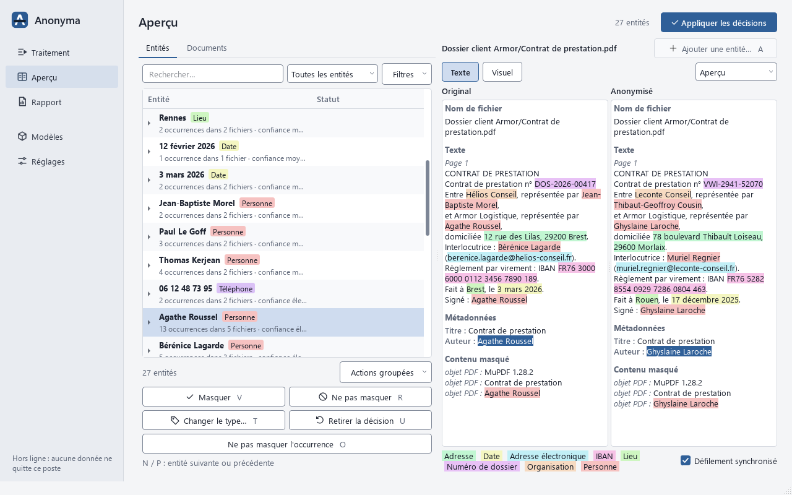
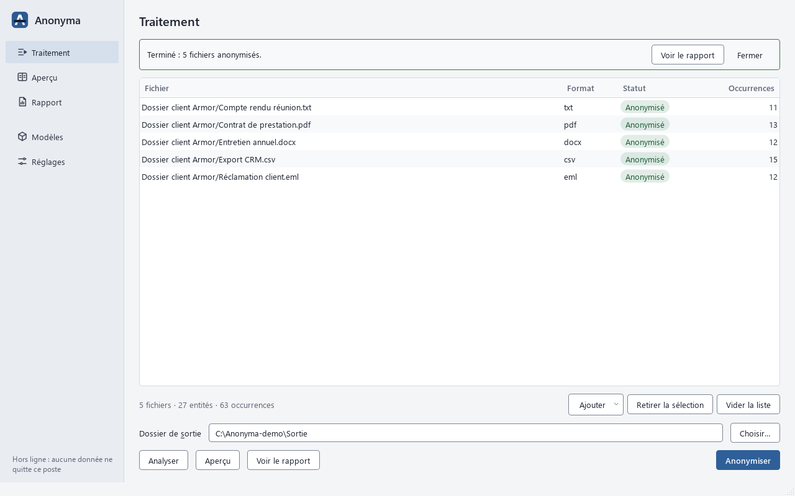
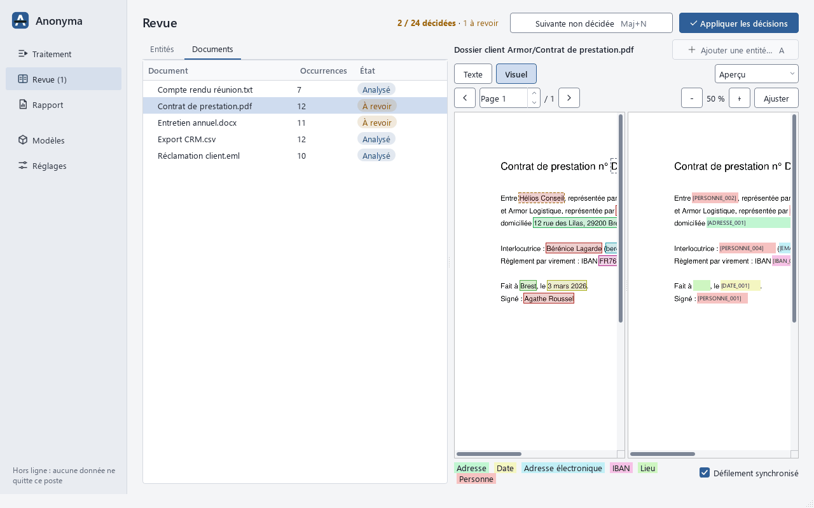
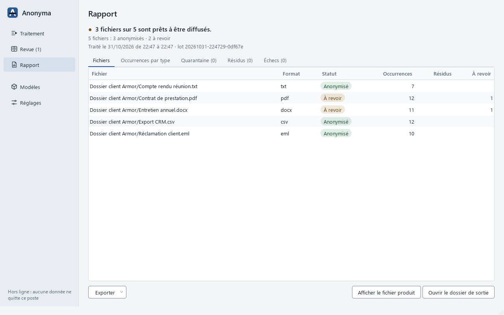
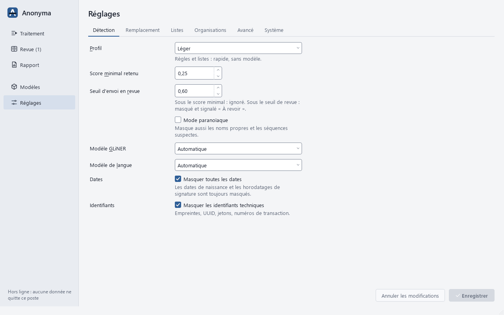

# Anonyma

Anonyma retire les données personnelles de vos documents, en masse et **sans rien
envoyer sur Internet**. Noms, adresses, courriels, téléphones, IBAN, numéros de sécurité
sociale… sont remplacés partout de la même façon. Chaque fichier garde son format et sa
mise en forme. Anonyma **relit ensuite chaque fichier produit** pour vérifier qu'il ne
reste rien.



> [!CAUTION]
> **Usage interne uniquement.** Anonyma contient des composants sous licence AGPL-3.0 et
> GPL-3.0 : il ne doit pas être distribué en dehors de l'entreprise. Voir
> [LICENSES.md](LICENSES.md).
>
> Consultants : vous pouvez l'utiliser au sein de votre cabinet, y compris sur les
> documents de vos clients, et leur remettre les fichiers anonymisés. En revanche, ne
> remettez pas l'outil lui-même à un client (ni copie, ni installation chez lui).

## Démarrer

1. Téléchargez l'archive de votre système sur la
   [page des versions](https://github.com/Alegzandr/anonyma/releases/latest).
2. Décompressez-la où vous voulez (disque local, clé USB).
3. Lancez `Anonyma.exe` (Windows), `Anonyma.app` (macOS) ou `Anonyma` (Linux).

Rien n'est installé sur la machine : réglages et modèles restent dans le dossier. Pour
désinstaller, supprimez le dossier.

- **Windows** : placez le dossier sur un chemin court, par exemple `C:\Outils\Anonyma`.
- **macOS** (Mac Apple Silicon) : l'application n'est pas signée. Avant le premier
  lancement, ouvrez le Terminal et tapez la commande suivante, en adaptant le chemin :

  ```sh
  xattr -dr com.apple.quarantine /chemin/vers/Anonyma
  ```

  Laissez `Anonyma.app` dans son dossier.

## Anonymiser un lot

1. **Traitement** : déposez des fichiers ou des dossiers.
2. Choisissez un **dossier de sortie**, distinct de celui des originaux. Les originaux ne
   sont jamais modifiés.
3. Cliquez sur **Anonymiser**. Anonyma détecte, masque, relit chaque fichier produit et
   masque aussi ce que cette relecture trouve encore. Il ne vous demande rien : dans le
   doute, il masque.
4. Le **Rapport** donne le résultat de chaque fichier.
5. Pour voir ce qui a été masqué, double-cliquez sur un fichier : l'**Aperçu** montre
   l'original et le fichier anonymisé côte à côte. Vous pouvez y démasquer un mot masqué
   à tort, ou masquer un oubli, puis réappliquer ; ce n'est jamais nécessaire.

| Traitement | Aperçu visuel d'un PDF |
|---|---|
|  |  |
| **Rapport** | **Réglages** |
|  |  |

## Comprendre le résultat

| Statut | Ce que ça veut dire | Que faire |
|---|---|---|
| **Anonymisé** | Vérifié, rien à signaler. | Le fichier peut être partagé. |
| **À revoir** | Rare : une image n'a pas pu être lue, une pièce jointe illisible a été retirée, ou un doute subsiste même après la seconde passe. | Jetez un œil à l'aperçu avant de partager. |
| **Résidus** | Une donnée d'origine a été retrouvée : le fichier est mis en **quarantaine**. | Ne le diffusez pas. Masquez-la dans l'aperçu, puis réappliquez. |
| **Échec** ou **Non pris en charge** | Le fichier n'a pas pu être traité. Rien n'est produit. | Voir la raison dans le rapport. |

Le dossier de sortie ne contient que des fichiers vérifiés. Les fichiers en quarantaine
sont rangés à part, dans le dossier `<sortie>_quarantaine`, à côté de la sortie.

Anonyma ne recopie **jamais** un fichier qu'il n'a pas pu anonymiser : il le laisse de
côté et le signale.

## Ce qui est traité

| Famille | Formats |
|---|---|
| Bureautique | Word, Excel, PowerPoint (y compris les anciens `.doc`, `.xls`, `.ppt`), OpenDocument, RTF |
| PDF | PDF texte et PDF numérisés |
| Courriels | `.eml`, `.msg`, `.mbox`, `.pst` (avec leurs pièces jointes) |
| Données et texte | `.txt`, `.csv`, `.json`, `.xml`, `.html`, `.md`, `.log` |
| Images | `.png`, `.jpg`, `.tiff`, `.bmp`, `.heic`, `.webp` (le texte des images est lu et masqué) |
| Archives | `.zip`, `.7z` (contenu traité à l'intérieur) |

Chaque fichier ressort dans son format d'origine, avec la même arborescence. Les noms de
fichiers sont anonymisés aussi : `CV Jean Dupont.pdf` devient `CV [PERSONNE_001].pdf`.
Les métadonnées (auteur, historique, coordonnées GPS des photos…) sont supprimées. Seule
exception : une boîte `.pst` ressort sous la forme d'un dossier de courriels `.eml`.

## Réglages principaux

**Profil de détection** : plus le profil est poussé, plus Anonyma repère de noms, mais
plus il est lent.

| Profil | Pour qui |
|---|---|
| Léger | Toute machine. Repère les données bien formées (courriels, IBAN, téléphones…) et vos listes. |
| Standard | Conseillé, à partir de 6 Go de mémoire. Ajoute un modèle d'IA qui repère les noms de personnes, de lieux et d'organisations. |
| Complet | Machine puissante. Ajoute un modèle de langue, plus fin mais bien plus lent. |

Anonyma choisit le profil selon votre machine et installe seul les modèles d'IA qui
lui conviennent, en arrière-plan au démarrage : rien à choisir. Après une mise à jour,
il remplace les modèles périmés et supprime ceux qui ne servent plus. La page
**Modèles** montre où en est l'installation. Le profil Complet n'est pas disponible
dans la version portable : il y fonctionne comme Standard.

**Remplacement** : comment les données sont remplacées.
- **Réaliste** (par défaut) : `Jean Dupont` devient un autre nom vraisemblable, les
  adresses, organisations et domaines aussi, et les dates sont décalées.
- **Balises** : `Jean Dupont` devient `[PERSONNE_001]`.
- **Masquage** : `Jean Dupont` devient `█████`.

**Les liens sont conservés.** Une même valeur reçoit toujours le même faux élément, et
deux valeurs différentes jamais le même : en-têtes, corps, citations, pièces jointes et
noms de fichiers restent reliés, et un tri par interlocuteur, organisation ou fil donne
le même résultat que sur les originaux. En mode réaliste, c'est vrai aussi **d'un lot à
l'autre** : des mails traités en plusieurs fois gardent les mêmes faux noms, sans phrase
secrète. Anonyma garde pour cela, sur ce poste seulement (`data/liens.anonyma`), une
mémoire des faux éléments déjà donnés, sans aucune valeur d'origine. Pour repartir avec
des faux noms sans lien avec les lots précédents : bouton **Repartir avec de nouveaux faux
noms** des Réglages, ou `anonyma nouveaux-substituts`.

> Qui disposerait de cette mémoire et d'une liste de noms pourrait vérifier si l'un
> d'eux figurait dans un lot : tant qu'elle existe, les sorties sont, au sens du RGPD,
> des données pseudonymisées. Elle ne quitte jamais le poste et n'est écrite ni dans les
> sorties ni dans les rapports ; l'effacer rend les lots déjà produits anonymes.

**Anonymisation ou pseudonymisation**
- **Anonymisation** (par défaut) : aucune valeur d'origine n'est gardée.
- **Pseudonymisation** : les correspondances sont gardées dans une table chiffrée, pour
  pouvoir retrouver les vraies valeurs plus tard. Une phrase secrète protège cette table.
  **Une phrase secrète perdue rend la table définitivement illisible.**

**Listes** (onglet Listes des Réglages) : les valeurs à ne jamais masquer (le nom de
votre entreprise…) et les valeurs à toujours masquer (vos clients, vos projets…).

## Confidentialité

- **Vos documents ne quittent jamais la machine.** Anonyma bloque toute connexion
  pendant le traitement.
- Les seules connexions possibles se font au démarrage : les modèles d'IA adaptés à
  votre machine (Hugging Face) et les mises à jour (recherche, puis téléchargement si
  vous acceptez). Elles n'envoient aucune donnée, et vous pouvez les couper dans les
  Réglages : les modèles s'installent alors à votre demande, ou depuis un dossier sans
  réseau (page **Modèles**).
- Les originaux ne sont jamais modifiés.
- Les journaux et les rapports ne contiennent aucune donnée d'origine.

## Mises à jour

Au démarrage, Anonyma vous prévient quand une nouvelle version est disponible. Si vous
acceptez, il la télécharge, vérifie qu'elle est intacte, puis redémarre dessus. Vos
réglages, la table de correspondance et les modèles sont conservés. « Ignorer cette
version » ne vous la propose plus.

**Poste d'entreprise (proxy).** Anonyma passe par le proxy de Windows ou de macOS, comme
votre navigateur, et fait confiance aux certificats de votre entreprise installés sur le
poste. Si les mises à jour ou les téléchargements de modèles échouent quand même,
demandez l'adresse du proxy à votre service informatique et saisissez-la dans
**Réglages > Application > Proxy** (ex. `http://proxy.entreprise.fr:8080`).

## Ligne de commande

Anonyma s'utilise aussi sans interface, pour automatiser un traitement, avec
`anonyma-cli` (`anonyma-cli.exe` sous Windows) :

```sh
# Anonymiser un dossier vers un dossier de sortie, avec un rapport
anonyma-cli run "Dossiers clients" --sortie anonymises --rapport rapport.html

# Voir ce qui serait masqué, sans rien écrire
anonyma-cli analyser "Dossiers clients"

# Bilan JSON pour un script ou un agent
anonyma-cli run "Dossiers clients" -o anonymises --json --silencieux > bilan.json
```

La commande renvoie **0** si tout est anonymisé, **1** si un fichier est en quarantaine
ou en échec, et **2** en cas d'erreur d'utilisation. `anonyma-cli --help` liste toutes
les commandes.

## Bon à savoir

- **Dans le doute, Anonyma masque.** Mieux vaut un mot masqué en trop qu'un nom oublié.
  La détection automatique n'est jamais parfaite : regardez les fichiers « À revoir ».
- **Commentaires et révisions** : les commentaires Word sont conservés et anonymisés, et
  les révisions suivies sont acceptées.
- **Dates en mode réaliste** : toutes les dates du lot sont décalées du même nombre de
  jours, ce qui garde la chronologie. Revers de la médaille : qui connaît la vraie date
  d'un seul événement peut retrouver toutes les autres, sauf les dates de naissance, qui
  ont chacune leur propre décalage.

## Pour aller plus loin

- [REFERENCE.md](REFERENCE.md) : toutes les options de la ligne de commande, le bilan
  JSON, le détail par format, la sécurité et les limites connues.
- [LICENSES.md](LICENSES.md) : licences des composants et des modèles.
- [docs/DEVELOPMENT.md](docs/DEVELOPMENT.md) : travailler sur le code.
